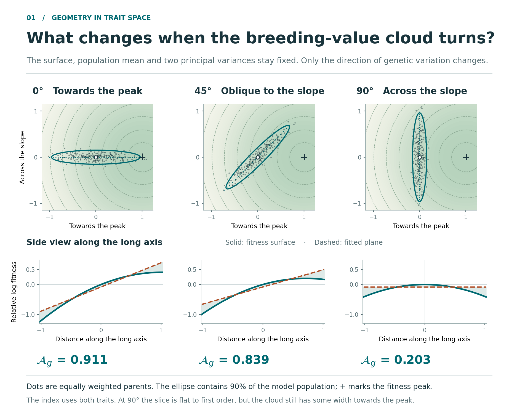
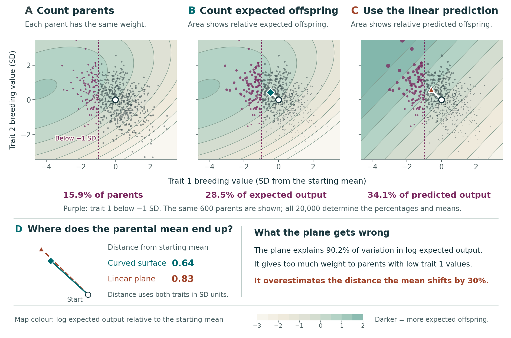

# Additive channels

### Genetic variation, fitness and selection

**Daniel Ortiz-Barrientos and Mark Cooper**

[](https://github.com/dortizbarrientos/additive_channels/actions/workflows/reproduce.yml)

Plants can differ genetically in height, and those differences can affect how much they reproduce. Suppose expected reproduction rises with breeding value and then falls. **What changes when the population varies less, while that fitness curve stays the same?**

Explore the comparison below. A line describes fitness variation more closely in the narrower population on the slope. Move that same narrow population to the peak, however, and its linear share falls to zero. The curve and the population distribution jointly determine the description.

[](tutorials/one_trait_visual/README.md)

This repository contains the code, simulated data and teaching resources for **Additive channels in curved fitness landscapes**. Follow an idea visually, work through its mathematics, or reproduce its numerical results. The [result catalog](RESULTS.md) connects the main figures, mathematical results and supplementary examples to their inputs, code and checks.

**[Explore](#explore-the-ideas)** · **[Reproduce](#reproduce-the-results)** · **[Estimate](#estimate-from-observations)** · **[Teach](tutorials/README.md)** · **[Find a result](RESULTS.md)**

## Explore the ideas

| Start with a biological question | Open the resource | Then try |
|---|---|---|
| How does a population change the linear description of fitness? | [One trait, three populations](tutorials/one_trait_visual/README.md) | Compare the curve, the population density and the fitted line. |
| Does the direction of genetic variation matter? | [Two-trait geometry](tutorials/geometry/README.md) · [illustrated guide](tutorials/geometry/figures/geometry_of_additive_channels.pdf) | Turn the population on a fixed surface in the [rotation explorer](tutorials/geometry/rotate_the_cloud.html). |
| Which parents contribute most to reproduction? | [Population frequencies and reproductive contributions](tutorials/parental_weighting/README.md) | Change the weights in the [parental-contribution explorer](tutorials/parental_weighting/explore_parental_cloud.html). |
| Can a close linear fit still mispredict selection? | [Four-page introduction](tutorials/introduction/notes.pdf) | Follow the worked example: a 97% linear share with a 50% overestimate of the selected-parent mean shift. |

| Change the direction of variation | Change the reproductive weights |
|:---:|:---:|
| [](tutorials/geometry/README.md) | [](tutorials/parental_weighting/README.md) |

**Use the explorers offline.** [Download the repository ZIP](https://github.com/dortizbarrientos/additive_channels/archive/refs/heads/main.zip), extract it, and double-click either HTML file listed above. Each explorer runs in your browser without a server or an internet connection. GitHub displays the HTML source when you follow its file link; downloading and opening the file runs the explorer.

## Reproduce the results

With Python 3.11 or newer and Bash installed:

```bash
git clone https://github.com/dortizbarrientos/additive_channels.git
cd additive_channels
bash run_all.sh
```

The default run regenerates the four main figures, checks the mathematical results and numerical examples, summarizes the **20 archived SLiM diagnostic tables**, and refits the worked estimation example with **500 bootstrap samples**. New calculations go to `outputs/` and are checked against the supplied reference results. If Python packages are missing, the launcher creates a local virtual environment and installs them; that first installation requires internet access.

| Command | What you get |
|---|---|
| `bash run_all.sh --quick` | Main figures, mathematical and numerical checks, and the archived simulation summary; skips the bootstrap refits. |
| `bash run_all.sh` | The quick calculation plus the worked estimation example and all 500 bootstrap refits. |
| `bash run_all.sh --visuals` | The one-trait illustration, two-trait geometry, parental-weighting figures, both offline explorers and the home-page visual. |
| `bash run_estimation.sh` | The worked example, uncertainty interval, tables and diagnostic figures. |
| `bash run_shiny.sh` | The interactive estimation app in your browser. |
| `bash run_all.sh --simulate` | Twenty fresh SLiM 5.2 replicates and comparison with the archived diagnostics. |
| `bash run_all.sh --tutorials` | Rebuilt teaching PDFs, worksheets and slide deck; see the [optional build dependencies](tutorials/README.md). |

Use the [reproduction guide](REPRODUCING.md) for expected outputs and troubleshooting, or the [complete result catalog](RESULTS.md) to find a particular figure, formula or supplementary example. The [tested package versions](requirements-tested.txt) record the reference environment.

## Estimate from observations

The [worked example](examples/estimating_variance_share/worked_example.pdf) starts with repeated noisy height measurements and offspring counts, including zeros. It estimates the fitness relationship while accounting for uncertainty in breeding values, then calculates the linear and curved variance components.

The **[Python Shiny app](examples/estimating_variance_share/README.md)** uses the same model and estimation code. Change the sample size, measurement error or fitness relationship, then select **Generate and estimate**. Inspect the fitted relationship, uncertainty and model checks together.

```bash
bash run_shiny.sh
```

## Read, teach and adapt

| Resource | Use it for |
|---|---|
| [Illustrated introduction](tutorials/introduction/notes.pdf) | A short route from offspring counts to population weighting and selection. |
| [Worksheet and solutions](tutorials/introduction/worksheet.pdf) | Working through the one-trait calculations in a class or reading group. |
| [Lecture slides](tutorials/introduction/slides.pdf) · [editable PowerPoint](tutorials/introduction/slides.pptx) · [speaker notes](tutorials/introduction/speaker_notes.md) | Teaching the biological questions and calculations in sequence. |
| [Mathematics guide](tutorials/mathematics/guide.pdf) | Step-by-step derivations, from one trait to Gaussian moments, selection, inheritance and several traits. |
| [Complete derivation companion](tutorials/derivations/derivations.pdf) · [result and equation maps](tutorials/derivations/README.md) | Following each result through its assumptions, mathematical concepts, intermediate algebra and biological interpretation. |
| [Geometry PowerPoint](tutorials/geometry/figures/geometry_of_additive_channels.pptx) · [parental-weighting PowerPoint](tutorials/parental_weighting/figures/parental_weighting.pptx) | Adapting the visual explanations for talks. |

The [teaching index](tutorials/README.md) gives a reading order and the source files needed to rebuild these resources.

## What the calculations describe

A **breeding value** sums the average effects of an individual's alleles on a trait in the population. The examples average reproductive output at each breeding value **before** taking its logarithm. The linear share describes variance in a quadratic approximation to that log conditional mean.

A large share identifies an additive channel for a population–fitness relationship. Predicting the selected-parent mean requires expected-output weighting as well as population frequencies. Predicting offspring additionally requires an inheritance model. The tutorials keep these calculations distinct.

All supplied observations are simulated or generated from specified mathematical populations. The [SLiM guide](slim/README.md) distinguishes replaying archived diagnostics from running new populations.

## Repository map

| Folder | Contents |
|---|---|
| [`code/`](code/) | Figure generators, mathematical checks, result comparisons and supporting scripts. |
| [`reference/`](reference/) | Saved figure results, result catalog and reference figures. |
| [`slim/`](slim/) | Forward-time model, runner, diagnostic calculations and 20 archived replicate tables. |
| [`examples/estimating_variance_share/`](examples/estimating_variance_share/) | Simulated data, estimator, 500 bootstrap results, diagnostic plots and Shiny app. |
| [`tutorials/`](tutorials/) | Visual explanations, offline explorers, derivations, worksheets and editable slides. |
| [`docs/images/`](docs/images/) | Home-page visuals generated by [`code/build_readme_visuals.py`](code/build_readme_visuals.py). |

## Reuse and citation

The code and accompanying documentation use the [MIT license](LICENSE). Please cite the resource when reusing its code, data or teaching materials; GitHub's **Cite this repository** menu uses [`CITATION.cff`](CITATION.cff).
