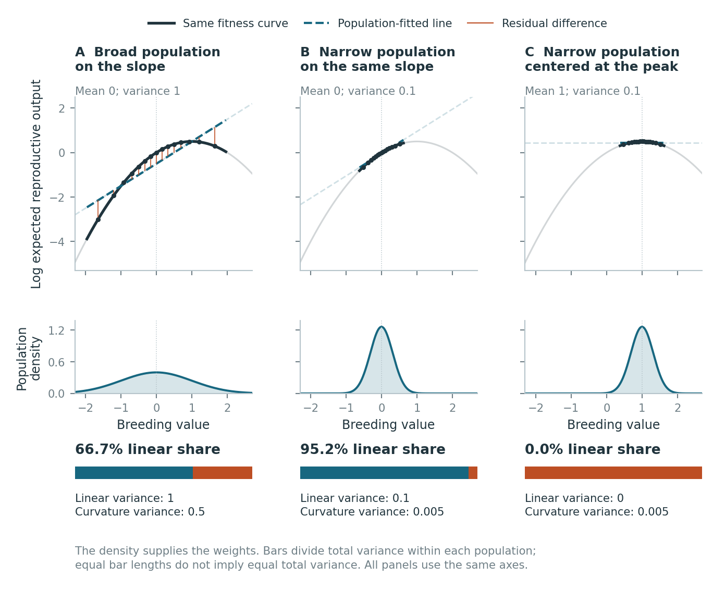

# Why can a curved fitness relationship look linear?

Two populations can share the same relationship between breeding value and expected reproduction, yet differ in how well a line describes fitness variation. The breeding values present—and how often they occur—help determine the fit. These tutorials let you change the population, inspect individual parents, and estimate the share from noisy measurements.

[](one_trait_visual/README.md)

## Start with a question

| Question | Explore | Check your understanding |
|---|---|---|
| **Can the population change the fit while the curve stays fixed?** | [One-trait walkthrough](one_trait_visual/README.md): compare a broad population, a narrow one and a population at the peak. | Explain why narrowing raises the share in one comparison but leaves it at zero in another. |
| **Does the direction of genetic variation matter?** | [Two-trait geometry](geometry/README.md): rotate the population on a fixed surface. | Separate turning the population from turning the viewing angle. |
| **Does a close fit predict who contributes to reproduction?** | [Follow individual parents](parental_weighting/README.md): switch from frequency weights to reproductive weights. | Compare the two weighted parental means; neither is an offspring mean. |
| **Can the share be estimated from observations?** | [Worked example and Shiny app](../examples/estimating_variance_share/README.md): use repeated height measurements and offspring counts. | Compare measurement uncertainty with failure of the quadratic assumption. |
| **Why do the formulas work?** | [Mathematics guide](mathematics/README.md): derive the one-trait result, then extend it to several traits and inheritance. | Use the checkpoints and worked answers before moving to the next calculation. |

The examples use specified mathematical populations or simulated data. Their generating values are available so you can check a calculation against a known answer. For a particular figure, formula or proof, use the [result index](../RESULTS.md) to find its source, output and numerical check.

## Open an explorer in your browser

Download either self-contained HTML file and open the saved file in a browser:

- [Download the geometry explorer](geometry/rotate_the_cloud.html?raw=1).
- [Download the parental-weighting explorer](parental_weighting/explore_parental_cloud.html?raw=1).

On GitHub, use **Download raw file** if a link opens the file viewer. If you downloaded the repository ZIP, unzip it first and double-click the HTML file in its tutorial folder. Both explorers work offline; they need no Python installation or local server. The module guides above give a short experiment to try in each.

## Estimate a share in Shiny

From the downloaded or cloned repository's root, run:

```bash
bash run_shiny.sh
```

Use Python 3.11 or newer. The launcher installs missing Python dependencies into a local environment on first use, then starts the app on your computer. Open `http://127.0.0.1:8000` if the browser does not open automatically. Stop the app with **Ctrl-C** in the terminal. [The app guide](../examples/estimating_variance_share/README.md) explains the controls, downloads and alternative port setting.

## Teach a short class

The [illustrated introduction](introduction/README.md) starts with offspring counts, derives the fitted line, and asks whether that line predicts the selected-parent mean. It includes a four-page explanation, a worksheet with solutions, slides, editable PowerPoint and speaker notes. A suggested 35-minute sequence is included.

## Rebuild the materials

The PDFs, slides and explorers are ready to use. To regenerate the three visual modules, run this from the repository root:

```bash
bash tutorials/build_visuals.sh
```

It uses the Python dependencies in the root requirements and needs no TeX, Node.js, R, SLiM or presentation software. Each module explains its independent numerical checks and optional PowerPoint export.

To rebuild the full teaching collection, run `bash run_all.sh --tutorials`. In addition to the Python requirements, install TeX Live or MacTeX with pdfLaTeX, latexmk, BibTeX, latex-extra, science and recommended fonts; Node.js with npm; and LibreOffice (`soffice`). The script rebuilds the diagrams, LaTeX PDFs, editable slides and slide PDF. First use installs PptxGenJS locally if needed. The worked-example PDF uses the reference tables and figures shipped beside its source.
