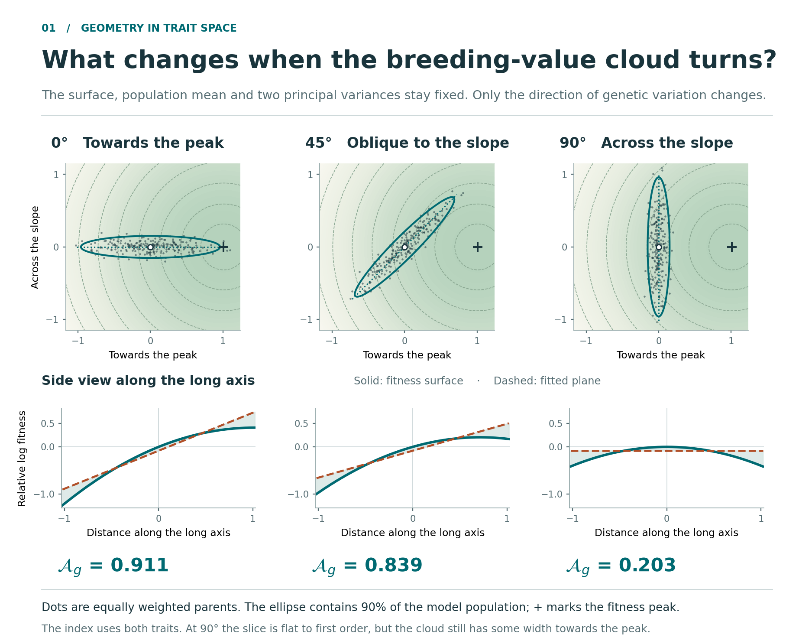

# Does the direction of genetic variation matter?

Two traits can vary mostly together or mostly in opposite directions. If the fitness surface stays fixed, can that change how well a plane describes fitness variation? Rotate the population to find out. Then compare populations with the same linear share but different predicted shifts among contributing parents.

[](rotate_the_cloud.html?raw=1)

**[Download the geometry explorer](rotate_the_cloud.html?raw=1)** and open the saved HTML file in a browser. On GitHub, choose **Download raw file** if the link opens the file viewer. The file contains its data and code; it works offline without installation or a server.

**All populations and plotted individuals here are simulated.** The numerical results use specified Gaussian distributions. The 225 dots illustrate those distributions and do not determine the reported variance shares. The module contains no empirical data and does not simulate inheritance.

## Open the figures or explorer

| Resource | Contents |
| --- | --- |
| [Two teaching plates](figures/geometry_of_additive_channels.pdf) | Covariance orientation on page 1; the variance decomposition and selected-parent comparison on page 2. |
| [Offline geometry explorer](rotate_the_cloud.html?raw=1) | Rotate the population, rotate the view, show the fitted plane, and change point sizes to expected reproductive weights. |
| [Editable PowerPoint](figures/geometry_of_additive_channels.pptx) | The two plates with native text labels and SVG artwork. |
| [Rotation plate as SVG](figures/rotating_breeding_value_cloud.svg) and [PNG](figures/rotating_breeding_value_cloud.png) | Individual files for reuse in teaching. |
| [Projection plate as SVG](figures/fitness_projection_angles.svg) and [PNG](figures/fitness_projection_angles.png) | Individual files for reuse in teaching. |
| [Numerical values](values.json) | Model parameters, variance components, shares, fitted intercepts, projection angles and selected-parent displacements. |
| [LaTeX captions](captions.tex) | Reusable scientific captions for the two teaching plates. |

## Try three changes

1. Choose **Uphill · 0°**, then **Across · 90°**. The surface, mean and principal variances stay fixed. The share falls from about 0.911 to 0.203 because the linear variance changes; the curvature variance stays at 0.012808 in this example.
2. Turn the **view** or show and hide the fitted plane. The drawing changes, but the share should stay fixed. These controls help separate a viewing angle from a change in the population.
3. Select **Size dots by expected offspring**. The same individuals receive different reproductive weights. Their positions and the initial population's variance share stay fixed.

At 90°, the long-axis section is horizontal to first order, but the share is still positive. Look for the population's remaining width towards the peak. The calculations below explain why that width matters.

Continue to the [parental-weighting tutorial](../parental_weighting/README.md) to inspect one parent's contribution under each weighting rule.

## 1. Rotating covariance on a fixed log-fitness surface

The fixed surface is the isotropic quadratic used for the two-trait covariance comparison (Figure 3 of *Additive Channels in Curved Fitness Landscapes*):

$$
\ell_A(a)=-0.4\lVert a-\theta\rVert^2,
\qquad \theta=(0.9375,0.375)^T.
$$

The Hessian is $H=-0.8I$, and the stabilising curvature is $\Gamma=-H=0.8I$. At mean zero, the gradient is $b=0.8\theta=(0.75,0.30)^T$.

For the first plate, rotate the coordinate axes so that $u$ points from the mean towards the fitness maximum and $v$ is perpendicular to it. This orthonormal change of coordinates preserves distances. The gradient length is $b_0=0.8\lVert\theta\rVert$, with $b_0^2=0.6525$, and

$$
\ell_A(u,v)-\ell_A(0,0)=b_0u-0.4(u^2+v^2).
$$

The Gaussian population has principal variances 0.20 and 0.005. Rotate its long axis through an angle $\phi$ relative to $u$, keeping its mean and both principal variances fixed. Then

$$
V_{\rm lin}=0.6525\{0.20\cos^2\phi+0.005\sin^2\phi\},
\qquad
V_{\rm quad}=0.32(0.20^2+0.005^2)=0.012808.
$$

The curvature variance stays fixed because this particular Hessian is proportional to the identity. With non-isotropic curvature, changing the orientation of covariance can also change the curvature variance.

| Long-axis orientation | Linear variance | Quadratic variance | First-order share |
| --- | ---: | ---: | ---: |
| 0° | 0.130500 | 0.012808 | 0.910626 |
| 45° | 0.06688125 | 0.012808 | 0.839276 |
| 90° | 0.0032625 | 0.012808 | 0.203012 |

The share remains positive at 90° because the short axis still carries variance in the direction of the gradient. The ellipse encloses 90% of the specified Gaussian population. The same sample of 225 points rotates between panels, using seed 20261111.

### How this relates to the paper's orientation result

The comparison changes the physical covariance matrix relative to a fixed gradient. It therefore changes $\lVert G^{1/2}b\rVert$. The paper also considers a different comparison: rotating the gradient in whitened coordinates while holding its whitened length and the curvature eigenvalues fixed. That second operation leaves the share unchanged. The two statements hold different quantities fixed and are consistent.

### What the side views show

Each side view is a section through the population mean along its long axis. If $t$ measures distance along that axis, its surface section is

$$
b_0t\cos\phi-0.4t^2.
$$

The population least-squares plane has the same slope but an intercept lower than the surface at the mean by $0.4(0.20+0.005)=0.082$. Its section is therefore $b_0t\cos\phi-0.082$. A horizontal section at 90° does not imply a horizontal plane: the plane still slopes along $u$. The variance calculation uses the full two-dimensional distribution, not a section through it.

## 2. The variance share as a projection

Subtract mean log expected fitness to obtain a centred outcome $F$. Let $P$ be its population least-squares linear projection and let $R=F-P$. On these Gaussian populations and quadratic surfaces, $P$ is the linear term and $R$ is the centred quadratic term. Orthogonality gives

$$
\operatorname{Var}(F)=\operatorname{Var}(P)+\operatorname{Var}(R).
$$

Their standard deviations give the lengths of a right triangle. After dividing all lengths by $\operatorname{SD}(F)$, the squared base length is $\mathcal A_g$. For a nonzero fitted component, the projection angle $\psi$ satisfies $\mathcal A_g=\cos^2\psi$. This is an angle between functions under population weighting. It is distinct from the physical covariance angle $\phi$, a slope of the surface, or a direction of evolutionary change.

At the fitness maximum the linear component vanishes. The displayed 90° is the limiting triangle angle; an ordinary vector angle with a zero fitted component is undefined.

The four comparison populations use

$$
G_0=\begin{pmatrix}1&0.3\\0.3&0.6\end{pmatrix}.
$$

| Case | Population mean | Covariance | Share |
| --- | --- | --- | ---: |
| A | $0$ | $G_0$ | 0.603954 |
| B | $0$ | $0.11G_0$ | 0.932720 |
| C | $\theta$ | $0.11G_0$ | 0 |
| D | $\theta(1-1/\sqrt{0.11})$ | $G_0$ | 0.932720 |

A and B reproduce the covariance comparison in Figure 3 of the main analysis. C and D extend the teaching example. B and D have the same share by construction. They differ in the absolute variance components and selected-parent displacements.

## 3. Weighting parents by expected reproductive contribution

The parental distribution after weighting is proportional to its initial density times $\exp(\ell_A)$. The curved surface gives a mean shift

$$
\Delta_{\rm full}=(G^{-1}+\Gamma)^{-1}b,
$$

while the fitted plane gives $\Delta_{\rm lin}=Gb$. Any additive constant in either log-fitness function cancels from its normalised parental weights.

In B the two displacement lengths round to 0.093 and 0.103; in D they round to 1.459 and 2.812. The lengths use **ordinary Euclidean distance in the same trait units**. The displayed percentage is the excess in predicted length, $\lVert\Delta_{\rm lin}\rVert/\lVert\Delta_{\rm full}\rVert-1$. It is not the norm of the vector prediction error in Equation (20), which uses the covariance-scaled norm. An offspring mean would require a transmission model.

The explorer's weighting checkbox changes point area in proportion to expected output. It does not draw offspring counts, calculate a new offspring population or change the variance share displayed for the initial population.

## Reproduce

From this directory, use Python 3 with NumPy and Matplotlib installed:

```bash
python3 -m pip install -r requirements.txt
bash run.sh
```

Installation requires a network connection if dependencies are missing. All subsequent calculations and the HTML explorer run offline. `PYTHON_BIN` can select a different interpreter.

The launcher runs:

1. `code/geometry.py`: analytic calculations and independent Gaussian-quadrature checks; rewrites `values.json`.
2. `code/figure.py`: creates the PDF, SVG and PNG teaching plates in `figures/`.
3. `code/explorer.py`: creates the self-contained `rotate_the_cloud.html` from its template and the fixed illustrative point sample.

The checks fit a plane by weighted least squares at 32-by-32 Gaussian quadrature points, compare the variance decomposition with the analytic formula, then independently weight the quadrature points by exponentiated surface and plane values. These integrations also check the selected-parent means. The checks cover all seven model populations.

The optional PowerPoint export uses the supplied script `code/export_pptx.py` and requires python-pptx, Pillow, lxml and Inkscape. The prebuilt PPTX is supplied for readers who only want to edit the figures.

## Provenance and limits

This module uses a fixed quadratic two-trait surface and explicitly specified Gaussian populations. The displayed cases were chosen to explain orientation and the distinction between variance share and selected-parent displacement; they do not estimate the prevalence of any biological pattern. The main paper's 97%/50% example is a separate one-trait calculation and is not used to label these figures.

The variance-component, population-projection and selected-parent formulas are derived in the [mathematics guide](../mathematics/README.md), with formal result locators in Appendices S1–S2 of *Additive Channels in Curved Fitness Landscapes*. The [parental-weighting guide](../parental_weighting/README.md) records the simulation provenance of its separate examples.
