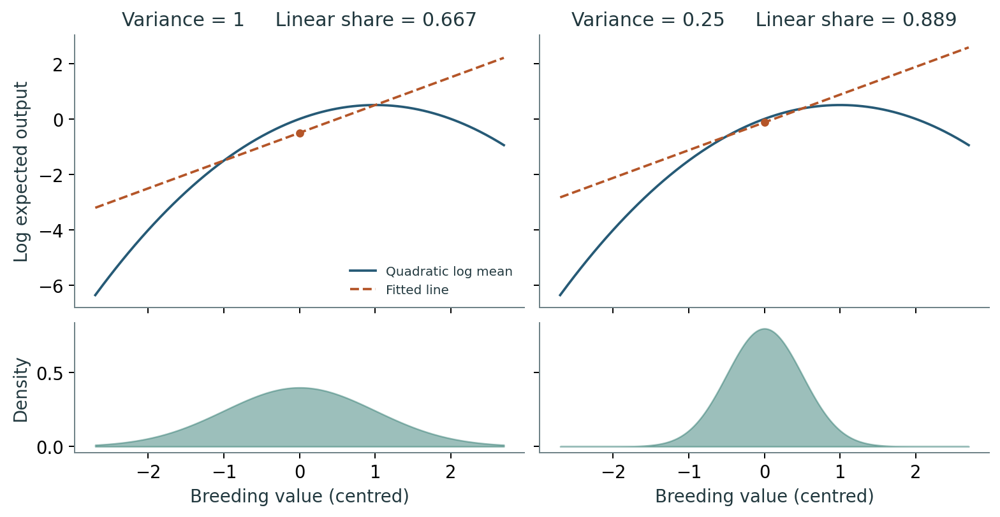

# Start with two plants and their offspring

Two plants can have the same breeding value for height but leave different numbers of offspring. If one leaves none and the other leaves four, their mean output is two. Begin there: average reproductive output first, then take its logarithm. The remaining pages ask how the population determines a linear fit and whether that fit predicts the mean among contributing parents.

[](notes.pdf)

## Read, calculate, discuss

- [Read the four-page illustrated introduction](notes.pdf).
- [Work through the worksheet and solutions](worksheet.pdf).
- [Present the slides](slides.pdf), [edit the PowerPoint](slides.pptx), or [read the speaker notes](speaker_notes.md).

A 35-minute class can follow this sequence:

| Time | Question | Activity |
|---|---|---|
| 5 minutes | What can be averaged when a parent has zero offspring? | Compare the log of a mean with a mean of logs. |
| 10 minutes | Why do the same curve and two populations give different fits? | Compare the densities and fitted lines; keep the curve fixed. |
| 10 minutes | Where do the two variance components come from? | Derive the variance of a normal variable's square and calculate both shares. |
| 10 minutes | Does a 97% fit predict selection accurately? | Complete the square and compare the exact selected-parent shift, 4/3, with the linear prediction, 2. |

## Check the biological meaning

The first diagrams use illustrative counts. The following calculations use Gaussian breeding-value distributions and specified quadratic log expected fitness. A large linear share describes fitness variation within a population; it is not a fraction of variation in observed offspring counts. The selected-parent mean also differs from an offspring prediction, which needs an inheritance model.

Continue to the [offline geometry explorer](../geometry/README.md) to change the direction of genetic variation, or the [Shiny estimation example](../../examples/estimating_variance_share/README.md) to work from noisy observations.

## Reproduce

From the repository root, `bash run_all.sh --tutorials` rebuilds the teaching collection. See the [build requirements](../README.md#rebuild-the-materials). The numerical checks for these examples can also be run on their own:

```bash
python3 tutorials/introduction/check_examples.py
```

The figure script is [make_figures.py](make_figures.py); the PDF sources are [notes.tex](notes.tex) and [worksheet.tex](worksheet.tex). The slide source is [build_slides.js](build_slides.js).
