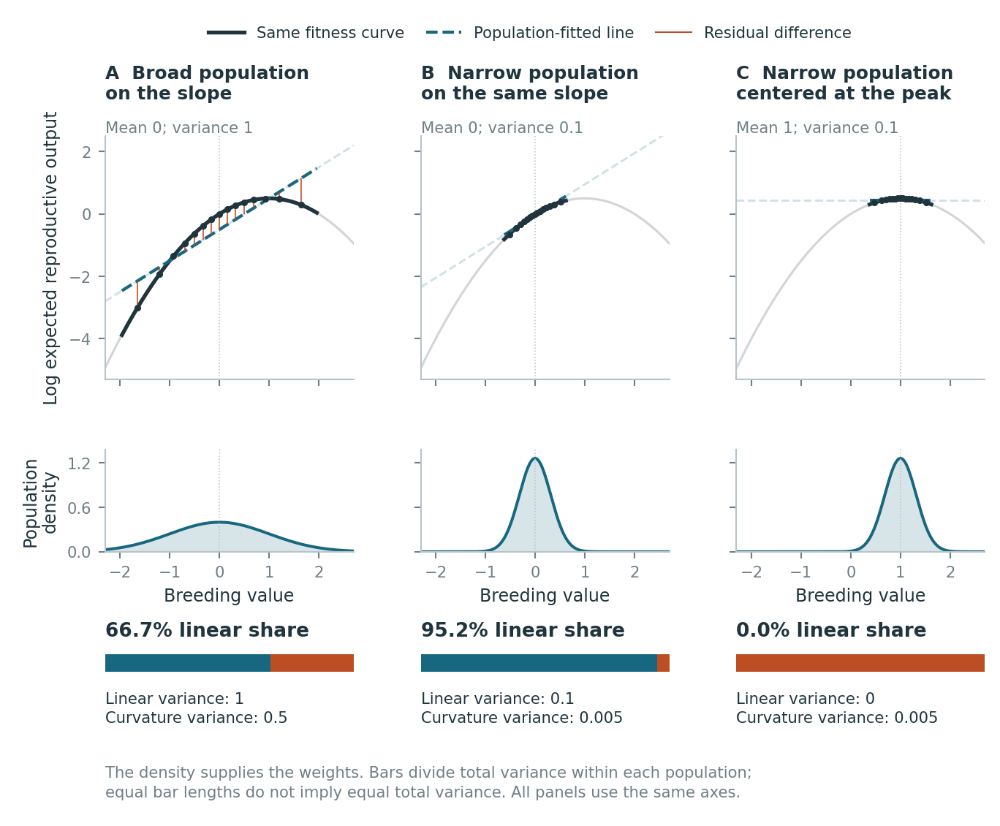

# Why does the same fitness curve give different linear fits?

The figure below compares three populations on one curved relationship between breeding value and log expected reproduction. The first two have the same mean. The third has the same narrow distribution as the second, but its mean lies at the peak.

[](../one_trait_visual/README.md)

**[Read the four-page illustrated notes](notes.pdf).** It begins with individual offspring counts, explains how to calculate the linear share, then asks whether a close fit predicts the mean among contributing parents. The first population comparison uses the same curve and variances as the first two panels above.

Before reading the calculation, ask yourself why the linear share rises when the first population narrows. Why does the equally narrow population at the peak have a share of zero?

<details>
<summary>Check your explanation</summary>

At a fixed mean on the slope, reducing breeding-value variance from 1 to 0.1 reduces the linear variance from 1 to 0.1 and the curved variance from 0.5 to 0.005. The curved contribution falls faster, so the linear share rises from 66.7% to 95.2%. Both absolute components decline. At the peak, the slope is zero. All remaining variation comes from curvature, so the linear share is zero.

</details>

**Next: [follow the parents and their reproductive contributions](../parental_weighting/README.md).** This shows why describing variation and predicting selection require different weights. The four-page introduction gives the calculation; the next tutorial lets you inspect the parents.

For more help with the algebra, the [mathematics guide](../mathematics/README.md) develops the calculation through worked examples and checkpoints. You can also return to the [one-trait figure walkthrough](../one_trait_visual/README.md) for an explanation of each panel.

For the main reading options, see the [short companion and interactive study guide](../README.md).

## For a class or reading group

The [worksheet and solutions](worksheet.pdf) follow the same examples. Use the [slides](slides.pdf), [editable PowerPoint](slides.pptx) and [speaker notes](speaker_notes.md) to teach them. A 35-minute class can follow this sequence:

| Time | Question | Activity |
|---|---|---|
| 5 minutes | What can be averaged when a parent has zero offspring? | Compare the log of a mean with a mean of logs. |
| 10 minutes | Why do the same curve and two populations give different fits? | Predict the effect of narrowing, then compare the densities and fitted lines. |
| 10 minutes | Where do the two variance components come from? | Derive the variance of a normal variable's square and calculate both shares. |
| 10 minutes | Does a 97% fit predict selection accurately? | Complete the square and compare the exact selected-parent shift, 4/3, with the linear prediction, 2. |

## Fitness variation and offspring counts

The first diagrams use illustrative counts. The following calculations use Gaussian breeding-value distributions and specified quadratic log expected fitness. A large linear share describes fitness variation within a population; it is not a fraction of variation in observed offspring counts. The selected-parent mean also differs from an offspring prediction, which needs an inheritance model.

## Reproduce

From the repository root, `bash run_all.sh --tutorials` rebuilds the teaching collection. See the [build requirements](../README.md#rebuild-the-materials). The numerical checks for these examples can also be run on their own:

```bash
python3 tutorials/introduction/check_examples.py
```

The figure script is [make_figures.py](make_figures.py); the PDF sources are [notes.tex](notes.tex) and [worksheet.tex](worksheet.tex). The slide source is [build_slides.js](build_slides.js).
