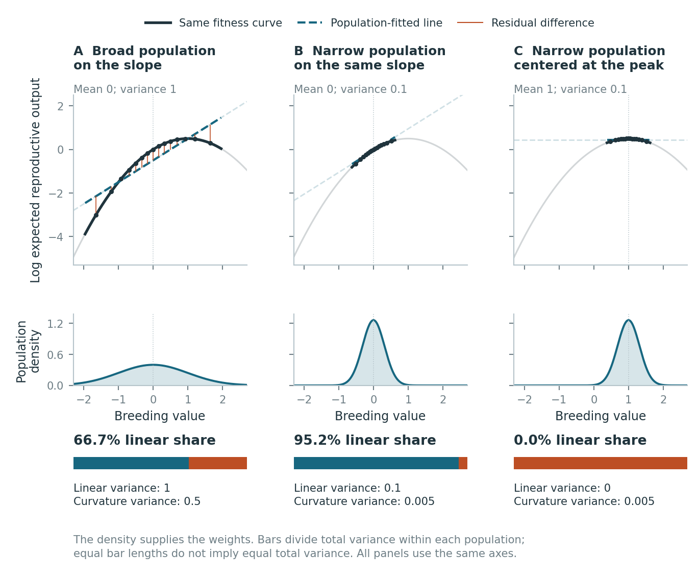

# Can one fitness curve give different linear fits?

Suppose expected reproduction rises and then falls as breeding value for height increases. Would a line describe fitness equally well in a broad population, a narrow population, and a population centered at the peak? Keep the curve fixed and compare the three populations below. This walkthrough uses no matrix notation. All examples are specified mathematical populations.

[](figures/one_trait_additive_channel.pdf)

[Open the PDF](figures/one_trait_additive_channel.pdf), [download the SVG](figures/one_trait_additive_channel.svg?raw=1), or [inspect the numerical values](values.json).

## Try the comparison

1. Compare **A and B**. Their means and fitness curve are identical. Which variance component falls faster as the population narrows?
2. Compare **B and C**. They have the same variance. Why does moving the mean to the peak remove the linear contribution?
3. Look at the equally long bars. Are the populations equally variable, or do the bars show fractions of different totals? Check the component values printed below them.

## Check the calculation

The same relationship holds in every panel: log expected reproductive output is `ell(a) = a - a²/2`. Breeding value `a` is measured in the same arbitrary units throughout. The maximum occurs at `a = 1`.

| Population | Mean breeding value | Breeding-value variance | Linear variance | Curvature variance | Linear share |
|---|---:|---:|---:|---:|---:|
| A: broad, on the slope | 0 | 1 | 1 | 0.5 | 2/3 = 66.7% |
| B: narrow, on the same slope | 0 | 0.1 | 0.1 | 0.005 | 20/21 = 95.2% |
| C: narrow, centered at the peak | 1 | 0.1 | 0 | 0.005 | 0% |

The density tells us how frequently breeding values occur. The dashed line minimizes mean squared prediction error across that distribution. It includes an intercept: it is not the tangent through the curve at the population mean. Vertical segments show differences between that line and the curve at equally spaced population quantiles. Dark sections span the central 95% of each population; all calculations use the complete Gaussian distribution.

The variance share describes how closely an additive prediction represents variation in log expected fitness. Here a one-trait additive prediction is a straight line. With several traits it adds a linear contribution from each trait. A high share is a property of a particular population together with its fitness relationship. Narrowness alone does not ensure a high share, as population C shows. Equal-length bars compare fractions, not total amounts of variation; the component variances are printed below them.

## Reproduce the figure

From the repository root:

```bash
python3 tutorials/one_trait_visual/make_figure.py
```

Dependencies are NumPy, SciPy and Matplotlib, already included in the root requirements. The script writes PDF, PNG and SVG versions under `figures/` and exact results to `values.json`. It verifies both component variances by independent numerical integration over the full distribution.

## Distinguish representation from selection

This figure weights the squared log-fitness deviations by the frequency of breeding values. Selection instead weights individuals by expected reproductive output, `exp(ell(a))`. A high linear share alone does not establish an accurate selected-parent shift, an offspring response, or a statement about how individual alleles interact. The [introductory derivation](../introduction/README.md) gives the separate 97%/50% example, and the [parental-weighting tutorial](../parental_weighting/README.md) lets you inspect the change of weights directly.

For two traits, continue to the [geometry tutorial](../geometry/README.md). Its rotation example changes the direction of breeding-value variation on a fixed fitness surface. Its projection triangles concern functions evaluated across the population, a different geometry from the physical rotation of a two-trait distribution.
