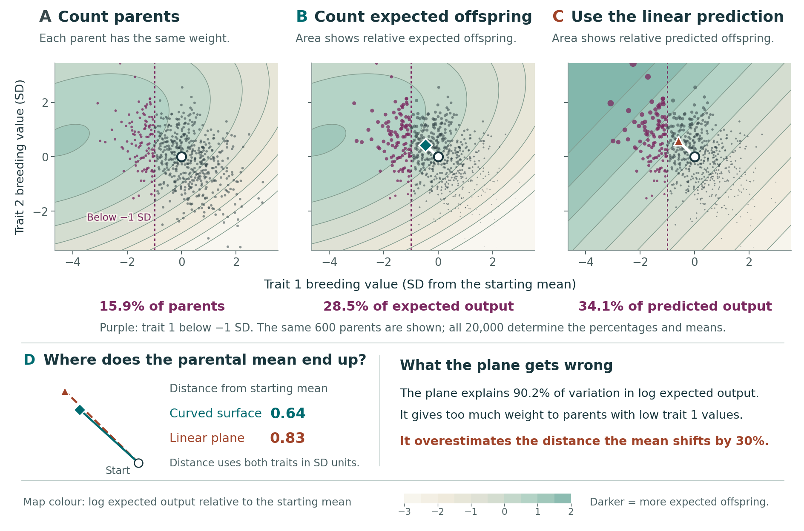

# Do common breeding values contribute most of the offspring?

Frequency tells us how many parents have a breeding value. Expected reproductive output tells us how much each contributes. Follow the same simulated parents under three weighting rules to see why a close linear description of fitness can still mispredict the selected-parent mean. A second example compares expected contributions with recorded simulated offspring counts.

[](explore_parental_cloud.html?raw=1)

**[Download the parent explorer](explore_parental_cloud.html?raw=1)** and open the saved HTML in a browser. On GitHub, use **Download raw file** if the link opens the file viewer. It works offline without Python or a server.

## Try the weights

1. Start with **One per parent**. The purple group contains 15.9% of the population. Enter a parent ID and note its breeding values.
2. Choose **Expected offspring: curved surface**. That group's expected contribution rises to about 28.5%. Your selected parent stays at the same coordinates; its weight changes.
3. Choose **Predicted offspring: fitted plane**. The group receives about 34.1%. Compare the parental mean markers as well as the dot sizes: the fitted plane overestimates the displacement length by about 30.1% in this selected example.
4. Switch between 600 displayed parents and all 20,000. The numerical results should stay fixed because every calculation already uses all parents.

The two-trait explorer uses expected reproductive contributions, not sampled offspring counts. It does not simulate transmission to offspring. The recorded-count example below makes the additional sampling distinction explicit.

## Open the materials

| Resource | Use |
| --- | --- |
| [Parental-weighting figure](figures/parental_weighting.pdf) | Three views of the same parental points and a comparison of weighted means. |
| [Offline parent explorer](explore_parental_cloud.html?raw=1) | Inspect any of the 20,000 simulated parents and switch its displayed weight. Download the HTML and open it in a browser. |
| [Recorded-count teaching figure](figures/tutorial_cloud_recorded_offspring.pdf) | Compare equal, expected and realised-count weights in the saved one-trait simulation. |
| [Editable parental-weighting figure](figures/parental_weighting.pptx) and [count figure](figures/tutorial_cloud_recorded_offspring.pptx) | Native text labels and embedded SVG artwork. |
| [Numerical results](data/results.json) and [all parental values](data/parent_cloud.csv.gz) | Full-precision calculations and a row for every simulated parent. |
| [Caption fragment](captions.tex) | Text for reuse in a separate teaching document. |

SVG and PNG versions accompany each PDF. The [geometry companion](../geometry/) explains covariance orientation, fitted planes and the variance-share projection.

## Where the two-trait population came from

The module replays the Figure 2 Gaussian validation generator with seed 20260905 and selects its 25th two-trait scenario, using one-based indexing. Each of its 20,000 parents has two simulated breeding values. The curvature is stabilising. The example was chosen because it combines a high sample linear fit with a substantial discrepancy in the predicted selected-parent displacement. This is a selected illustration, not an estimate of how frequently that combination occurs.

The generator's ordered random draws are preserved. Replaying all 360 scenarios reproduces the archived median, 95th percentile and maximum absolute discrepancies within 1e-10. The scientific generator in `code/fitness_scenarios.py` preserves the numerical procedure from `code/figures.py` at repository commit `10a865c`; its presentation text has been updated. `data/fitness_scenario_results.json` supplies the reference values for the numerical-equivalence check.

These individuals come from the Gaussian validation experiment. They are not SLiM individuals or measured plants. The print figure shows 600 parents sampled uniformly without replacement, with display seed 2511. All 20,000 determine the means, percentages and fit; the displayed subset does not enter the calculations. The explorer can display either the subset or everyone.

## What is fitted

For each simulated parent i, evaluate its known quadratic log expected fitness, ℓ_i. Fit a plane with an intercept to these log values by ordinary least squares. Its prediction is ℓ̂_i.

The **sample plane explains 90.2095%** of variation in these log values. The **population Gaussian share is 90.3601%** for the generating parameters. These are different quantities: the former is an empirical least-squares fit to this finite cloud; the latter uses the specified Gaussian distribution. The Gaussian validation experiment's empirical squared-correlation diagnostic is also recorded separately in `data/results.json`.

The map colours are shifted by a constant separately for each surface, giving zero at the starting mean. Such a constant cancels from normalised reproductive weights. It does not alter any mean or percentage.

## Three weighting rules

For the same parental values a_i:

$$
w_i^{\rm equal}=1/N,\qquad
w_i^{\rm curved}=\frac{\exp(\ell_i)}{\sum_j\exp(\ell_j)},\qquad
w_i^{\rm plane}=\frac{\exp(\hat\ell_i)}{\sum_j\exp(\hat\ell_j)}.
$$

Summing weights over a specified group gives its contribution. Summing weighted breeding values over all parents gives the selected-parent mean. Parents with trait 1 below one starting-population standard deviation make up 15.9% of the population. They contribute 28.4668% of expected output under the curved surface and 34.1268% under the plane.

Dot area is proportional to expected contribution, and radius is proportional to its square root. The average area is the same under all three weightings before subsampling. Each point remains at its original breeding-value coordinates. Only its contribution changes.

For the reported displacement length, subtract the sample mean and divide each trait by its own starting-population standard deviation. The curved and plane-weighted shifts are approximately (-0.473, +0.429) and (-0.593, +0.580). Their lengths are 0.638049 and 0.829949, giving a **30.0759% overestimate of length**.

This is Euclidean distance after marginal trait standardisation. It is not full covariance whitening. The displayed percentage compares displacement lengths; it is not the norm of the vector prediction error in the covariance-scaled error bound (Equation 20 of the main analysis). The two-trait weights are expected reproductive contributions, not realised offspring counts. Predicting offspring breeding values would also require an inheritance model.

## The one-trait companion with recorded simulated counts

The files `data/simulation_truth.csv` and `data/observed_data.csv` are copied from the [worked-estimation example](../../examples/estimating_variance_share/README.md) and match it byte for byte. Genotype IDs connect known simulated breeding values with simulated counts of surviving offspring. The 800 records include 88 zero counts and 2,862 offspring in total.

The count-weighted mean is

$$
\frac{\sum_i W_i a_i}{\sum_i W_i}.
$$

The high group contains 122 parents with breeding value more than one standard deviation above the sample mean. Their recorded simulated counts total 585 offspring. Thus their count-weighted contribution is 585/2,862 = 20.4403%, compared with 15.25% of the parents. Parents with zero offspring remain in the initial population and contribute zero to the count-weighted mean.

The figure also shows expected weights from the generating quadratic relationship and its fitted linear description. It uses the known simulated breeding values to explain weighting. It does not re-estimate those values from noisy height measurements or repeat the measurement-error analysis in that example. The high group is the upper tail in this example; selection favours the lower tail of trait 1 in the two-trait example. The group definitions therefore differ deliberately.

## Reproduce

From this directory, with Python 3 available:

```bash
python3 -m pip install -r requirements.txt
bash run.sh
```

The first command needs a network connection if dependencies are missing. Once installed, the module runs offline. `PYTHON_BIN` can select a specific interpreter.

| Script | Operation |
| --- | --- |
| `code/calculate.py` | Replays the Figure 2 random stream; checks the archived validation summaries; fits the selected plane; computes weights, group contributions and mean shifts; writes `data/results.json` and `data/parent_cloud.csv.gz`. |
| `code/draw.py` | Draws both teaching figures from the checked data and writes PDF, SVG and PNG files to `figures/`. |
| `code/export_interactive.py` | Builds the self-contained `explore_parental_cloud.html` from the same parent table and template. |
| `code/fitness_scenarios.py` | Scientific generator for the Gaussian validation scenarios; imported by the calculation script. |
| `code/export_pptx.py` | Optional export of the existing SVG figures to editable PowerPoint files. Requires python-pptx, Pillow, lxml and Inkscape. |

Regeneration replaces derived results and figures in this folder. It does not overwrite the saved height observations or simulation truth. The prebuilt figures and HTML are supplied for readers who only want to inspect or teach the examples.

## Provenance

The primary numerical definitions are the conditional selection weight, Gaussian variance share and selected-parent moments. The [mathematics guide](../mathematics/README.md) explains them, with formal derivations located in Appendices S1–S2 of *Additive Channels in Curved Fitness Landscapes*. The saved-count companion reuses the [worked estimation data](../../examples/estimating_variance_share/README.md). All numerical results here concern these specified model populations. Neither the visual similarity of a plane nor a high variance share establishes additive gene action or an offspring response.
